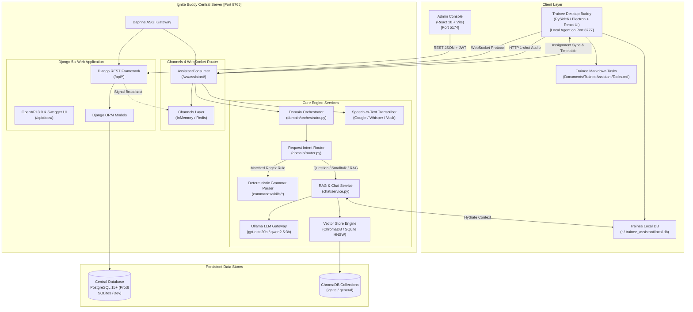
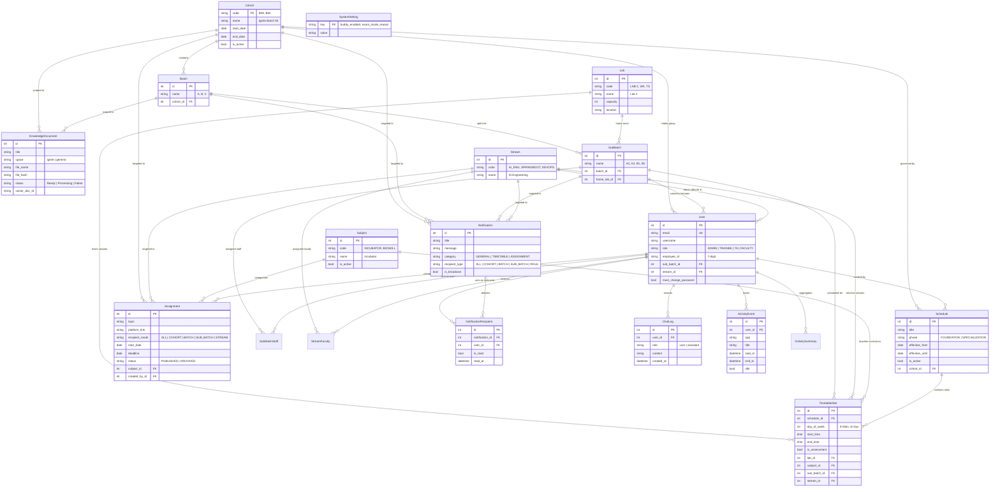
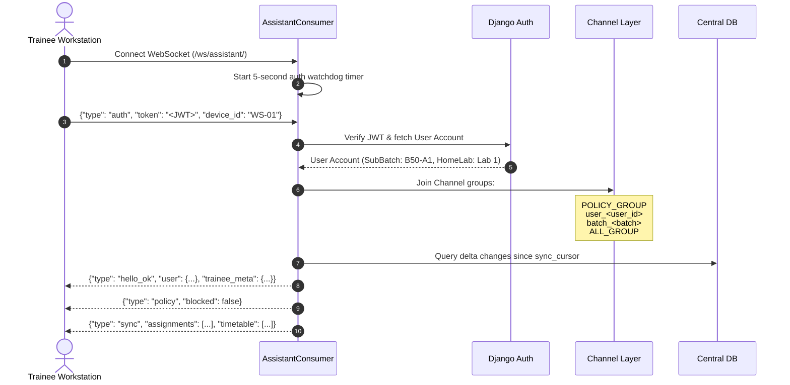
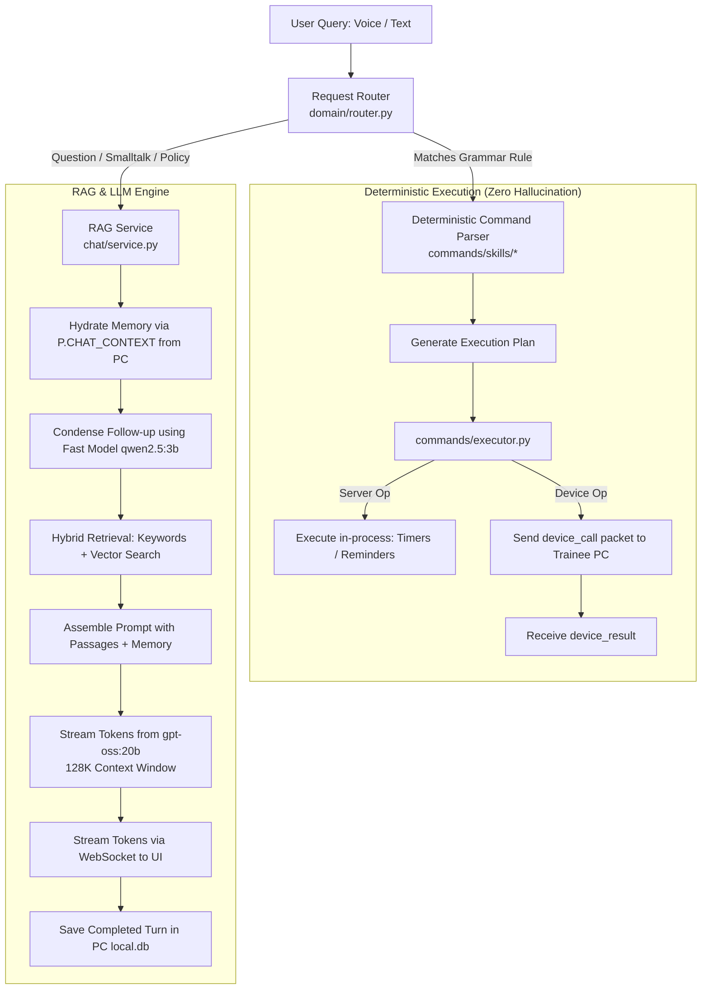

# Ignite Buddy: Comprehensive Backend & Database Developer Guide

> **Target Audience**: Backend Engineers, Systems Architects, and Technical Leads working on the **Ignite Buddy** platform.  
> **Location in Repository**: `docs/BACKEND_AND_DATABASE_GUIDE.md` (and mirrored in `src/server/README.md`).

---

## 1. System Architecture & Topology

The **Ignite Buddy** system operates on an event-driven, hybrid architecture engineered for enterprise campus environments (specifically the **TCS Ignite Program**).



---

## 2. Database Schemas & Entity-Relationship Modeling

The persistence model consists of **three distinct tiers**:
1. **Central Django Relational Database** (PostgreSQL in production, SQLite in development).
2. **Central Vector Knowledge Base** (ChromaDB / SQLite HNSW fallback).
3. **Trainee PC Local Storage** (SQLite `local.db` + Plaintext Markdown `Tasks.md`).

---

### 2.1 Central Relational Database (Django ORM)

The relational schema implements clean normalization (1NF/3NF), structured around the physical and organizational layout of the TCS Ignite training academy.

#### Entity Relationship Diagram (ERD)



---

### 2.2 App-by-App Model Specifications

#### 1. `server.apps.accounts`
- **`Cohort`**: Top-level trainee intake. Maps 300–500 trainees entering the 4-month program.
- **`Batch`**: Major technical streams/sections (e.g. `A`, `B`, `C`).
- **`SubBatch`**: Practical lab pods of 20–35 trainees (e.g. `A1` to `A4`, `B1` to `B4`), linked to a default physical `home_lab`.
- **`Lab`**: Physical rooms/suites in the campus (`Lab 1`, `WA` - Work Area, `TS` - Training Suite).
- **`Stream`**: Elective technical specialization tracks for Month 4 (`AI Engineering`, `Springboot`, `DevOps`).
- **`Subject`**: Curriculum courses across Phase 1 Core (`Incubator`, `BizSkill`) and Phase 2 Specializations.
- **`User`**: Custom user inheriting `AbstractUser`. Uses `email` as primary identifier, enforces 7-digit `employee_id`, Accops VDI identifier, and role choices: `ADMIN`, `TRAINEE`, `TA`, `FACULTY`, `OWNER`, `HR`, `MANAGER`.

#### 2. `server.apps.assignments`
- **`Assignment`**: Assessment tasks published by instructors. Features multi-level scoping (`ALL`, `COHORT`, `BATCH`, `SUB_BATCH`, `STREAM`), `start_date`, `deadline`, and optional external submission links.
- **Real-Time Integration**: Automatically dispatches a WebSocket notification (`type: "trainee.notification", kind: "assignment"`) to connected trainees, triggering immediate idempotent insertion into the client's `Tasks.md`.

#### 3. `server.apps.buddy_controller`
- **`SystemSetting`**: Thread-safe key-value table (`key`, `value`) for global runtime toggles:
  - `buddy_enabled`: Master switch allowing or blocking assistant connections.
  - `exam_mode_reason`: Broadcasted justification when locked.
- **`LabWorkstation`**: Inventory of physical workstations and VDI terminals.
- **Blackout System**: Automatically enforces assistant lockouts (+/- 15 minutes around scheduled assessment slots).

#### 4. `server.apps.documents`
- **`KnowledgeDocument`**: Admin-uploaded corporate and program policy documents (PDF, DOCX, TXT).
- **Vector Ingestion**: Automatically chunked (500 tokens, 50-token overlap) and embedded via `nomic-embed-text` into ChromaDB or SQLite HNSW.
- **Deletion Hook**: Deleting a document record cleans up associated vector chunks from the embedding store.

#### 5. `server.apps.notifications`
- **`Notification`**: Master announcement record with hierarchical scoping filters (`target_cohort`, `target_batch`, `target_sub_batch`, `target_stream`, `target_role`).
- **`NotificationRecipient`**: Read receipt tracking per user without duplicating message bodies.

#### 6. `server.apps.schedules`
- **`Schedule`**: Timetable header defining validity dates, active status, and program phase (`FOUNDATION` vs `SPECIALIZATION`).
- **`TimetableSlot`**: 1NF normalized weekday lecture and lab slots with `day_of_week` (0=Mon to 6=Sun), `start_time`, `end_time`, `lab`, `subject`, and `is_assessment` blackout flags.
- **`grid_data`**: Dynamic property that compiles the relational slots into structured JSON for frontend grid rendering.

#### 7. `server.apps.telemetry`
- **`ChatLog`**: Audit record of trainee questions and assistant responses.
- **`ActivityEvent`**: Window focus and application usage samples captured from client sensors.
- **`ActivitySummary`**: Aggregated daily/weekly time tracking summaries.

---

### 2.3 Vector Store Architecture (ChromaDB / SQLite HNSW)

The knowledge base in `src/server/knowledge/` indexes company and space documentation:
- **Collections**:
  - `ignite`: Ignite space policies, lab security, workstation etiquette, cafeteria timings, Accops VDI guidelines.
  - `general`: Company-wide HR policies, IT code of conduct, leave regulations.
- **Embedding Model**: `nomic-embed-text` (768-dimensional embeddings) running locally on Ollama.
- **Retrieval Thresholds**: `RAG_TOP_K=5`, cosine similarity cutoff `KB_MIN_SCORE=0.55`.
- **SQLite Fallback**: In environments without native C++ compilation tools for ChromaDB, vectors fall back to an internal cosine-similarity SQLite vector table.

---

### 2.4 Trainee PC Local SQLite Storage (`local.db`)

Every trainee computer maintains its own private, client-side SQLite database at:
```text
C:\Users\<username>\.trainee_assistant\local.db
```
Managed by `src/client/localdb.py`.

```sql
CREATE TABLE IF NOT EXISTS chat_turns(
    id INTEGER PRIMARY KEY,
    ts REAL,
    question TEXT,
    answer TEXT
);

CREATE TABLE IF NOT EXISTS audit_log(
    id INTEGER PRIMARY KEY,
    ts REAL,
    op TEXT,
    args TEXT,
    status TEXT,
    detail TEXT
);

CREATE TABLE IF NOT EXISTS assignments(
    id TEXT PRIMARY KEY,
    title TEXT,
    description TEXT,
    due_ts REAL,
    status TEXT DEFAULT 'pending',
    updated_ts REAL
);

CREATE TABLE IF NOT EXISTS timetable(
    id TEXT PRIMARY KEY,
    weekday INTEGER,
    start TEXT,
    end TEXT,
    title TEXT,
    location TEXT
);

CREATE TABLE IF NOT EXISTS kv(
    key TEXT PRIMARY KEY,
    value TEXT
);
```

> [!NOTE]
> **Privacy by Design**: Trainee conversation turns are saved in `chat_turns` on the trainee's local PC. When the trainee asks a question answered by RAG, the server queries the local machine via `P.CHAT_CONTEXT` to load conversational context, answers the prompt, and writes the turn back to the local PC's `local.db`.

---

### 2.5 Trainee Markdown Vault (`Tasks.md`)

Trainee workflow tasks are stored as plain Markdown checklist items in:
```text
%USERPROFILE%\Documents\TraineeAssistant\Tasks.md
```
Managed by `src/client/device/vault.py`.

#### Metadata Syntax:
```markdown
# Tasks

- [ ] [Assignment] Django REST API Lab @due(2026-11-20) @aid(asg-101)
- [ ] Review Accops VDI security guidelines @due(2026-11-15)
- [x] Submit weekly attendance timesheet
```

- **`@due(YYYY-MM-DD)`**: Due date tag parsed at load time.
- **`@aid(<id>)`**: Unique assignment ID matching the central Django database.
- **Dynamic Rollover**: Tasks with due dates before `datetime.date.today()` that are not marked `[x]` are dynamically evaluated as **Rolled Over from Yesterday** and rendered with amber warning badges in the UI.
- **Idempotent Sync**: Incoming assignment notifications automatically update or insert tasks in `Tasks.md` without creating duplicates.

---

## 3. Real-Time WebSocket Architecture

WebSocket connections are managed by `AssistantConsumer` in `src/server/realtime/consumer.py`:



---

## 4. Deterministic Command vs. RAG Pipeline



---

## 5. Developer Guide: How-To Guides

### 5.1 Local Environment Setup

```powershell
# 1. Clone repository
git clone https://github.com/your-org/Ignite_Buddy.git
cd Ignite_Buddy

# 2. Create virtual environment
python -m venv .venv
.venv\Scripts\activate

# 3. Install dependencies in editable mode
pip install -e .

# 4. Initialize Database
python manage.py migrate
python manage.py createsuperuser

# 5. Start Backend Server
ignite-server
```

---

### 5.2 How to Add a New Model & Migration

1. Add your model to `src/server/apps/<app>/models.py`:
   ```python
   from django.db import models

   class Workshop(models.Model):
       title = models.CharField(max_length=200)
       date = models.DateField()
       speaker = models.CharField(max_length=100)

       def __str__(self):
           return self.title
   ```
2. Generate migration:
   ```powershell
   python manage.py makemigrations
   ```
3. Apply migration:
   ```powershell
   python manage.py migrate
   ```

---

### 5.3 How to Add a New REST API Endpoint

1. In `src/server/apps/<app>/serializers.py`:
   ```python
   from rest_framework import serializers
   from .models import Workshop

   class WorkshopSerializer(serializers.ModelSerializer):
       class Meta:
           model = Workshop
           fields = "__all__"
   ```
2. In `src/server/apps/<app>/views.py`:
   ```python
   from rest_framework import viewsets
   from server.apps.accounts.permissions import IsAdmin
   from .models import Workshop
   from .serializers import WorkshopSerializer

   class WorkshopViewSet(viewsets.ModelViewSet):
       queryset = Workshop.objects.all()
       serializer_class = WorkshopSerializer
       permission_classes = [IsAdmin]
   ```
3. In `src/server/apps/<app>/urls.py`:
   ```python
   from rest_framework.routers import DefaultRouter
   from .views import WorkshopViewSet

   router = DefaultRouter()
   router.register(r"workshops", WorkshopViewSet, basename="workshops")
   urlpatterns = router.urls
   ```
4. The endpoint is automatically documented in Swagger UI at `/api/docs/`.

---

### 5.4 How to Add a New Assistant Voice/Text Command

1. Open `src/server/commands/skills/` and create or edit a skill file (e.g., `workspace.py`):
   ```python
   from server.commands.registry import tool, rule, SAFE

   @tool("clear_cache", SAFE, "Clear temporary workspace cache.", {})
   def clear_cache(session):
       # Execution logic
       return {"msg": "Workspace cache cleared successfully."}

   @rule(r"(?:clear|clean) (?:my )?cache", examples=("clear my cache",))
   def _clear_cache_rule(match, builder):
       builder.add("clear_cache")
   ```
2. Ensure the skill module is imported in `src/server/commands/skills/__init__.py`.
3. If the command runs on the trainee's local workstation, register a `device_tool` and implement `op_<name>` in `src/client/device/executor.py`.

---

### 5.5 Running Tests

```powershell
# Run all server tests
pytest tests/server/

# Run RAG and conversation tests
pytest tests/server/test_rag_and_chat.py
pytest tests/server/test_conversation.py

# Run tasks and vault CRUD tests
pytest tests/client/test_vault_files_native.py -k tasks
```

